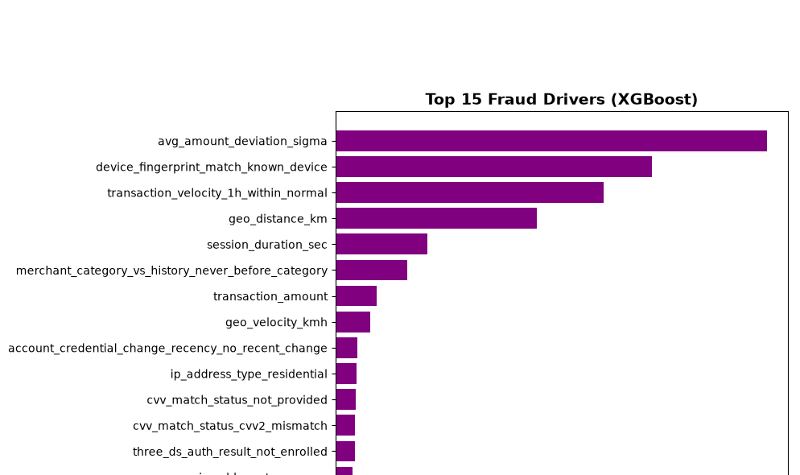
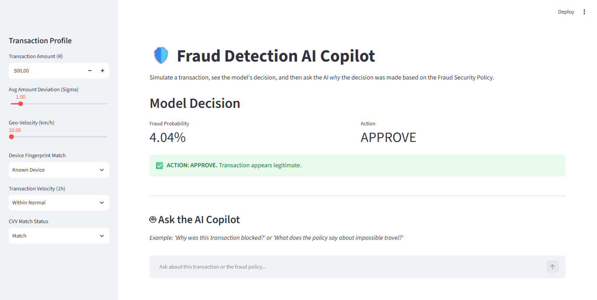
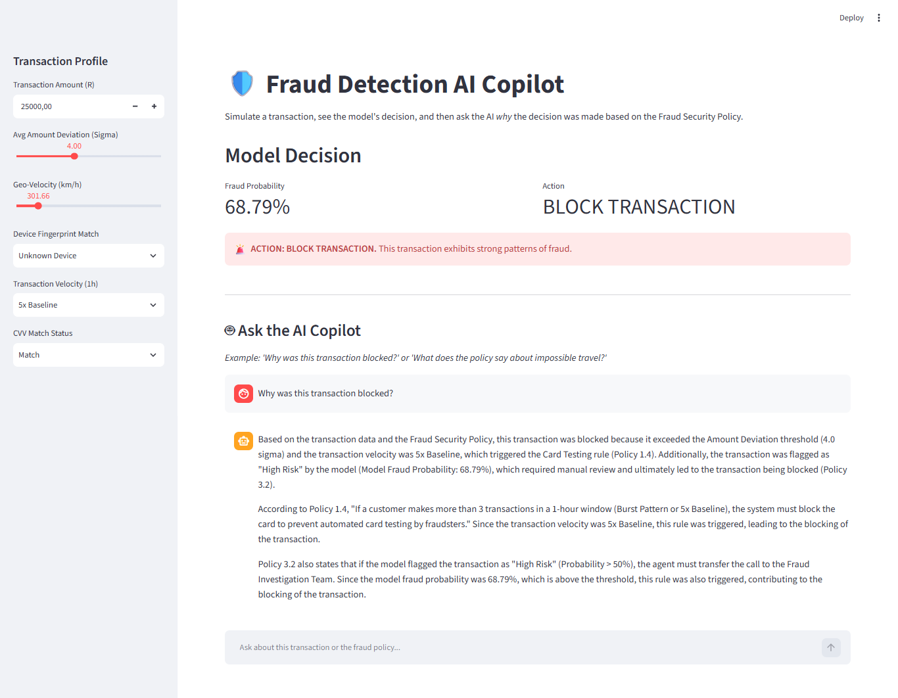

# AI-FDE-Fraud-Risk-Copilot

# Credit Card Fraud Detection: AI FDE Copilot

## Overview
This repository demonstrates the application of an **AI Forward Deployed Engineer (FDE)** in the Fraud domain. It combines a high-performance Machine Learning model (XGBoost) trained on 2.4 million credit card transactions with a **Local LLM (Llama 3) RAG Pipeline**. 

The system not only predicts whether a transaction is fraudulent but also provides an AI Copilot that explains *why* a transaction was blocked to customer service agents, citing the bank's exact security policy.

## 1. Machine Learning Model (XGBoost)
*   **Data Engineering:** Utilized PyArrow to chunk-load a 15-million-row Parquet file, extracting a time-representative sample of 2.4 million rows without crashing memory.
*   **Imbalance Handling:** Addressed a 4.9% fraud rate using `scale_pos_weight`.
*   **Performance:** Achieved **98% Recall** and **97% Precision**, drastically reducing false positives compared to a Logistic Regression baseline.
*   **Leakage Prevention:** Dropped features like `cards_on_device_30d` due to suspiciously high correlation (0.75) with the target.


*Figure 1: Top Fraud Drivers. Behavioral anomalies (Amount Deviation) and Device Intelligence are stronger predictors than raw transaction amount.*

## 2. AI Forward Deployed Engineering (GenAI / LLM)
Customer service agents cannot read XGBoost feature weights. To solve this, we built an **AI Copilot** using **Ollama (Llama 3)**, **LangChain**, and **ChromaDB**.

When a transaction is flagged, the agent can ask the AI why. The AI uses **Retrieval-Augmented Generation (RAG)** to read the `Fraud_Security_Policy.txt` and explain the decision in plain English.

## Interactive Dashboard

### 1. The Normal Flow (Approved)
For a standard transaction (e.g., R500, Known Device, Normal Velocity), the XGBoost model correctly outputs a low risk probability and **APPROVES** the transaction.



### 2. The Exception Flow (Blocked)
### 2.1 The AI Copilot (Exception Handling)

Step1: Customer service agents cannot read XGBoost feature weights. When a transaction is blocked, the agent asks the AI: "Why was this transaction blocked?" The RAG pipeline reads the Fraud Security Policy and explains the exact rules triggered.

Step 2: AI Explanation The agent asks: "Why was this transaction blocked?" The AI analyzes the transaction data, searches the policy document, and explains the exact rules triggered.
When a transaction exhibits strong fraud patterns (e.g., R25,000, Unknown Device, Impossible Geo-Velocity, Avg_ampint_deviation(sigma), the model catches it and outputs a **BLOCK TRANSACTION** decision.



## How to Run the App
1. Clone the repository.
2. Install the required packages: `pip install streamlit pandas scikit-learn xgboost langchain langchain-community langchain-ollama langchain-chroma chromadb`
3. Download [Ollama](https://ollama.com/) and pull the models:
   - `ollama pull llama3`
   - `ollama pull nomic-embed-text`
4. Run the Streamlit App:
   ```bash
   streamlit run fraud_ai_fde.py
